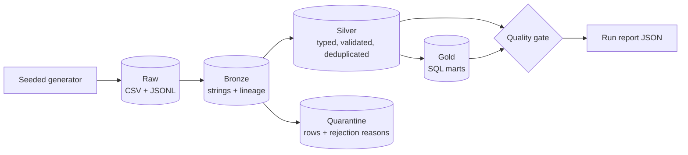

# Medallion Data Pipeline

[](https://github.com/batreides08/medallion-data-pipeline/actions/workflows/ci.yml)


An end-to-end batch data pipeline in **PySpark and SQL**. It takes messy retail data through the
**Medallion architecture** (Bronze, Silver, Gold) and blocks a run when the results fail their
data quality checks.

The point of the project is the engineering around the transformations: nothing is dropped
silently, re-running is safe, and the numbers are verified rather than assumed.

## Architecture



| Layer | Purpose | Contents |
| --- | --- | --- |
| **Bronze** | Replayable copy of each delivery | `customers`, `products`, `orders`, partitioned by `_batch_id` |
| **Silver** | Trustworthy entities | `customers`, `products`, `orders`, `order_items` |
| **Quarantine** | Rejected rows, kept for inspection | The same entities plus `_rejection_reasons` |
| **Gold** | Business marts in plain SQL | `daily_revenue`, `customer_lifetime_value`, `product_performance` |

Design decisions and the data model are in [docs/architecture.md](docs/architecture.md).

## Key features

- **Quarantine instead of data loss.** Rows that break a rule are stored with the name of every
  rule they broke. Malformed JSON is kept verbatim.
- **Idempotent runs.** Re-running a batch replaces only that batch, and Silver is rebuilt from all
  of Bronze by default, so repeated deliveries do not create duplicates. With `--incremental`,
  only batches missing from a watermark file (`state/watermark.json`) are cleaned and merged into
  Silver; a test checks the result equals a full rebuild.
- **Column contracts on raw CSV files.** Spark maps CSV columns to a schema by position and only
  logs a warning when the header disagrees, so a delivery with reordered columns would silently put
  emails in `full_name`. Bronze checks each header first and then reads columns by name: reordered
  columns are mapped correctly, extra ones are logged and ignored, and a missing or duplicated
  required column stops the run (exit code 1) before Bronze is written, without retries.
- **A quality gate that can stop a run.** It checks primary keys, required fields and references
  between tables, and reconciles revenue across every Gold mart to the cent. The report is written
  even when the gate fails.
- **Rejection-rate monitoring.** The report records what share of each entity's rows in the batch
  went to quarantine, and the gate fails when any share is above a limit (10% by default), so a
  broken delivery cannot quietly publish a half-empty Silver layer.
- **Run history and trend check.** Every run appends its row counts, rejection rates and outcome to
  `state/run_history.jsonl`. Once three passing runs exist, the gate also fails an entity whose
  rejection rate is more than 5 points above the median of recent passing runs, which catches a
  drift that is still under the absolute limit.
- **Layer tasks with retries.** Bronze, Silver, Gold and the quality gate each run as their own
  task. `--retries N --retry-delay S` retries a failing layer with exponential backoff, while a
  failed quality gate is never retried. The orchestrator is a small standard-library module
  (`orchestrator.py`) rather than Airflow or Prefect: the chain is linear and single-machine, so a
  scheduler service would add moving parts without benefit. Schedule it with any free tool, for
  example cron: `0 2 * * * medallion-pipeline run --incremental --retries 2`.
- **Customer history (SCD Type 2).** `gold/dim_customer` keeps every version of a customer with a
  `[valid_from, valid_to)` range, and `gold/order_customer_version` joins each order to the version
  valid when it was placed. Only attribute changes create a version.
- **Static BI dashboard.** `medallion-pipeline dashboard` renders the Gold marts (revenue trend,
  customer value segments, lifetime revenue by country, category and top-product revenue) as one
  self-contained HTML page with inline SVG, with no JavaScript, paid tools or external assets.
- **Atomic publishing with Delta Lake.** Silver, Quarantine and Gold are Delta tables. A run builds
  them in `state/candidate`, runs the quality gate there and only then copies them over the live
  tables, so a failed gate leaves the previously published data untouched. Each commit is a
  numbered version that can be read back (time travel). Bronze stays Parquet.
- **Table retention (VACUUM).** `medallion-pipeline vacuum` deletes the data files of Delta
  versions older than a retention window (168 hours by default, Delta's own safety limit) and
  logs the files and bytes freed per table. A shorter window needs `--allow-short-retention`,
  because a reader that started earlier may still need those files.
- **Verifiable tests.** The generator injects a known number of defects and states how many rows
  each table must end up with, so the tests compare against an independent source of truth.
- **Synthetic data only.** Everything is produced from a seeded random generator, so results are
  reproducible and no real people or companies are involved.

## Quick start

Requires Python 3.12+ and Java 17 or 21.

```bash
python -m venv .venv
source .venv/bin/activate
pip install -e ".[dev]"
medallion-pipeline generate --data-dir data
medallion-pipeline run --data-dir data
```

The lake is written to `data/`, with a report at `data/reports/run_<batch_id>.json`.

The report holds row counts, the share of each entity's rows in this batch that went to quarantine,
and every quality check. To change how much quarantine a batch may produce before it fails:

```bash
medallion-pipeline run --data-dir data --max-rejection-rate 0.05

# Merge only batches not yet processed (first run falls back to a full build)
medallion-pipeline run --data-dir data --incremental
```

With the seeded data, about 5.7% of products are rejected, so this example fails on purpose with
`rejection_rate:products` and exit code 1.

Render the dashboard from the Gold marts and open `data/dashboard/index.html`:

```bash
medallion-pipeline dashboard --data-dir data
```

Query the results with any Delta reader, for example from `pyspark` with the Delta extensions
(`medallion_pipeline.spark.create_spark_session` configures them):

```python
spark.read.format("delta").load("data/gold/daily_revenue").orderBy("order_date").show(5)
# An earlier published version of the same table
spark.read.format("delta").option("versionAsOf", 0).load("data/gold/daily_revenue")
```

Bound the disk used by old versions (time travel then reaches back 7 days):

```bash
medallion-pipeline vacuum --data-dir data
# Keep only the latest version; safe only when nothing else reads the lake
medallion-pipeline vacuum --data-dir data --retain-hours 0 --allow-short-retention
```

## Testing

```bash
pytest --cov
ruff check .
ruff format --check .
```

Every pull request runs linting, the tests on Python 3.12 and 3.13, and a full pipeline run through
[GitHub Actions](.github/workflows/ci.yml).

### Running on Windows

Hadoop needs the third-party `winutils.exe` binary to write files on Windows. This project does not
install it. Without it, reading and transforming work but writing Parquet does not, so tests marked
`parquet_io` are skipped with a stated reason and the `run` command fails. They always run in CI.

If your Windows user name contains a space, Java may also fail with `Unable to establish loopback
connection`. Point it at a directory without spaces before running:

```powershell
$env:JAVA_TOOL_OPTIONS = '-Djdk.net.unixdomain.tmpdir=C:\Windows\Temp'
```

## Project structure

```text
src/medallion_pipeline/
├── data_generator.py   Seeded raw data with known defects
├── contracts.py        Column contracts checked on raw CSV headers
├── bronze.py           Raw ingestion with lineage
├── silver.py           Typing, validation, deduplication, quarantine
├── scd2.py             Customer history (dim_customer) and point-in-time order join
├── gold.py             Runs the SQL marts
├── tables.py           Delta read/write helpers and table versions
├── maintenance.py      VACUUM of the published Delta tables
├── dashboard.py        Static HTML dashboard over the Gold marts
├── sql/gold/           One .sql file per mart
├── quality.py          Quality gate
├── orchestrator.py     Task runner with per-task retries and backoff
├── pipeline.py         Defines the layer tasks of one run
└── cli.py              generate, run, dashboard and vacuum commands
tests/                  Unit and end-to-end tests
docs/architecture.md    Design decisions and data model
```

## Roadmap

Planned work is tracked in [GitHub Issues](https://github.com/batreides08/medallion-data-pipeline/issues).

## AI attribution

This project is developed with [Claude Code](https://claude.com/claude-code), Anthropic's AI coding
agent, under human direction and review. Commits written with its help carry a `Co-Authored-By`
trailer, and every change goes through a pull request for human approval.

## License

[MIT](LICENSE)
