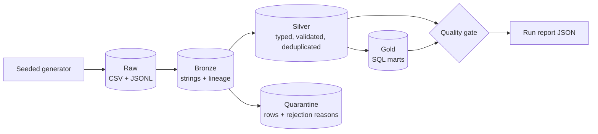

# Medallion Data Pipeline

[](https://github.com/batreides08/medallion-data-pipeline/actions/workflows/ci.yml)


An end-to-end batch data pipeline in **PySpark and SQL**. It takes messy retail data through the
**Medallion architecture** (Bronze, Silver, Gold) and blocks a run when the results fail their
data quality checks.

The point of the project is the engineering around the transformations: nothing is dropped
silently, re-running is safe, and the numbers are verified rather than assumed.

## Architecture



| Layer | Purpose | Contents |
| --- | --- | --- |
| **Bronze** | Replayable copy of each delivery | `customers`, `products`, `orders`, partitioned by `_batch_id` |
| **Silver** | Trustworthy entities | `customers`, `products`, `orders`, `order_items` |
| **Quarantine** | Rejected rows, kept for inspection | The same entities plus `_rejection_reasons` |
| **Gold** | Business marts in plain SQL | `daily_revenue`, `customer_lifetime_value`, `product_performance` |

Design decisions and the data model are in [docs/architecture.md](docs/architecture.md).

## Key features

- **Quarantine instead of data loss.** Rows that break a rule are stored with the name of every
  rule they broke. Malformed JSON is kept verbatim.
- **Idempotent runs.** Re-running a batch replaces only that batch, and Silver is rebuilt from all
  of Bronze by default, so repeated deliveries do not create duplicates. With `--incremental`,
  only batches missing from a watermark file (`state/watermark.json`) are cleaned and merged into
  Silver; a test checks the result equals a full rebuild.
- **A quality gate that can stop a run.** It checks primary keys, required fields and references
  between tables, and reconciles revenue across every Gold mart to the cent. The report is written
  even when the gate fails.
- **Rejection-rate monitoring.** The report records what share of each entity's rows in the batch
  went to quarantine, and the gate fails when any share is above a limit (10% by default), so a
  broken delivery cannot quietly publish a half-empty Silver layer.
- **Verifiable tests.** The generator injects a known number of defects and states how many rows
  each table must end up with, so the tests compare against an independent source of truth.
- **Synthetic data only.** Everything is produced from a seeded random generator, so results are
  reproducible and no real people or companies are involved.

## Quick start

Requires Python 3.12+ and Java 17 or 21.

```bash
python -m venv .venv
source .venv/bin/activate
pip install -e ".[dev]"
medallion-pipeline generate --data-dir data
medallion-pipeline run --data-dir data
```

The lake is written to `data/`, with a report at `data/reports/run_<batch_id>.json`.

The report holds row counts, the share of each entity's rows in this batch that went to quarantine,
and every quality check. To change how much quarantine a batch may produce before it fails:

```bash
medallion-pipeline run --data-dir data --max-rejection-rate 0.05

# Merge only batches not yet processed (first run falls back to a full build)
medallion-pipeline run --data-dir data --incremental
```

With the seeded data, about 5.7% of products are rejected, so this example fails on purpose with
`rejection_rate:products` and exit code 1.

Query the results with any Parquet reader, for example from `pyspark`:

```python
spark.read.parquet("data/gold/daily_revenue").orderBy("order_date").show(5)
```

## Testing

```bash
pytest --cov
ruff check .
ruff format --check .
```

Every pull request runs linting, the tests on Python 3.12 and 3.13, and a full pipeline run through
[GitHub Actions](.github/workflows/ci.yml).

### Running on Windows

Hadoop needs the third-party `winutils.exe` binary to write files on Windows. This project does not
install it. Without it, reading and transforming work but writing Parquet does not, so tests marked
`parquet_io` are skipped with a stated reason and the `run` command fails. They always run in CI.

If your Windows user name contains a space, Java may also fail with `Unable to establish loopback
connection`. Point it at a directory without spaces before running:

```powershell
$env:JAVA_TOOL_OPTIONS = '-Djdk.net.unixdomain.tmpdir=C:\Windows\Temp'
```

## Project structure

```text
src/medallion_pipeline/
├── data_generator.py   Seeded raw data with known defects
├── bronze.py           Raw ingestion with lineage
├── silver.py           Typing, validation, deduplication, quarantine
├── gold.py             Runs the SQL marts
├── sql/gold/           One .sql file per mart
├── quality.py          Quality gate
├── pipeline.py         Orchestrates one run
└── cli.py              generate and run commands
tests/                  Unit and end-to-end tests
docs/architecture.md    Design decisions and data model
```

## Roadmap

Planned work is tracked in [GitHub Issues](https://github.com/batreides08/medallion-data-pipeline/issues).

## AI attribution

This project is developed with [Claude Code](https://claude.com/claude-code), Anthropic's AI coding
agent, under human direction and review. Commits written with its help carry a `Co-Authored-By`
trailer, and every change goes through a pull request for human approval.

## License

[MIT](LICENSE)
