# Architecture

## Scenario

A fictional online retailer delivers three files: customers and products as CSV, and orders as
JSON Lines with nested items. The deliveries contain the problems real sources have: malformed
records, repeated orders, stale customer versions, broken references and impossible values.

The pipeline must turn them into reliable revenue reporting without losing any evidence of what
arrived.

## Data flow

```mermaid
flowchart TD
    subgraph Raw
        C1[customers.csv]
        P1[products.csv]
        O1[orders.jsonl]
    end
    subgraph Bronze
        C2[customers]
        P2[products]
        O2[orders]
    end
    subgraph Silver
        C3[customers]
        P3[products]
        O3[orders]
        I3[order_items]
    end
    subgraph Gold
        D[daily_revenue]
        L[customer_lifetime_value]
        R[product_performance]
    end
    C1 --> C2 --> C3
    P1 --> P2 --> P3
    O1 --> O2 --> O3
    O2 --> I3
    C3 -- known_customer --> O3
    P3 -- known_product --> I3
    O3 --> D & L & R
    I3 --> D & L & R
    C3 --> L
    P3 --> R
```

## Layer contracts

### Bronze

- Every field is read as a string, so a bad value cannot fail ingestion.
- Malformed JSON is kept in `_corrupt_record`.
- Each row carries `_source_file`, `_ingested_at` and `_batch_id`.
- Data is partitioned by `_batch_id`. Overwriting is dynamic, so re-running a batch replaces only
  that batch.

### Silver

| Table | Key | Rules |
| --- | --- | --- |
| `customers` | `customer_id` | ID present, valid email, parsable `updated_at`. Newest version wins. |
| `products` | `product_id` | ID present, non-negative price, parsable `updated_at`. Newest version wins. |
| `orders` | `order_id` | Well-formed record, ID present, known customer, known status, parsable timestamp, at least one item. |
| `order_items` | `order_id`, `line_number` | Known product, positive quantity, non-negative price. |

A rule that evaluates to NULL counts as broken. Silver is rebuilt from every Bronze batch on each
run unless `--incremental` is used.

### Incremental loading

`state/watermark.json` lists the Bronze batches already merged into Silver. An incremental run
cleans only the missing batches (plus the current one, so a replay is merged again) and merges
them into the existing tables with the same rules as a full rebuild: newest `updated_at` wins for
customers and products, newest ingestion wins for orders, and a re-delivered order replaces its
lines. Quarantine rows of a replayed batch are replaced, not duplicated. Merged tables are written
to `state/staging` and swapped in, because Spark cannot overwrite a path it is reading.

Known limits: an order rejected earlier for an unknown customer is not re-evaluated when that
customer arrives in a later batch (a full rebuild would accept it), and a record that disappears
from a replayed batch stays in Silver. Atomic publishing (issue #8) is the planned fix for
partial writes (now addressed by atomic publishing, see Orchestration).

A rejected line does not reject its order. The order stays valid and only the line moves to
quarantine, because the rest of the sale really happened.

### Gold

| Mart | Grain | Answers |
| --- | --- | --- |
| `daily_revenue` | Day (UTC) | How much do we sell per day? |
| `customer_lifetime_value` | Customer | Who are our most valuable customers? |
| `product_performance` | Product | What leads each category? |

Revenue is recognised for orders that are `placed`, `shipped` or `delivered`. Orders that were
`cancelled` or `returned` are excluded.

### Customer history (SCD Type 2)

Silver keeps one row per customer, so `scd2.py` rebuilds the history from the valid customer rows
in Bronze (the same rules, without deduplication). `gold/dim_customer` has one row per version:
`customer_key`, `customer_id`, `full_name`, `email`, `country`, `version_number`, `valid_from`,
`valid_to` (NULL while current) and `is_current`. A new version is created only when a tracked
attribute changes; the same instant delivered twice keeps the latest ingestion.
`gold/order_customer_version` gives, per order, the attributes valid at `order_ts`. An order placed
before the first known version takes that first version. The quality gate checks one current
version per customer, unique `(customer_id, valid_from)` and that every order matches a version.

Limit: the dimension is recomputed from all of Bronze on each run, which is cheap for a customer
table but does not follow the watermark.

### Orchestration

`pipeline.py` defines five tasks (bronze, silver, gold, quality, publish) and `orchestrator.py` runs
them in order. A failing task is retried with exponential backoff (`--retries`, `--retry-delay`); the
attempt counts are stored in the run result. A failed quality gate (`DataQualityError`) is never
retried, because repeating the same checks cannot change the outcome. A standard-library runner was
chosen over Airflow or Prefect because the chain is linear and single-machine; any scheduler, such
as cron, can invoke the CLI.

Each task's outcome, attempts and duration are recorded as a `TaskRun` and written to the run report
under `tasks`, with their sum as `total_task_seconds`. The duration adds up the attempts and leaves
out the backoff waits, so it measures work rather than waiting. The quality task writes the report
before `publish` runs, so the pipeline rewrites it once the chain stops; a failed gate or a failed
publish is therefore recorded with the timings of every task that ran. A failure in bronze, silver or
gold happens before any report exists and is only logged.

### Atomic publishing

Silver and Gold are Delta tables. `silver_task` and `gold_task` write to `state/candidate`, the
quality gate checks those tables, and `publish_task` copies them over the live tables, one Delta
commit per table. If the gate fails, `publish` never runs: live tables, their versions and the
watermark stay as they were. Earlier versions are read with `versionAsOf`
(`tables.read_table(..., version=n)`).

### Dashboard

`medallion-pipeline dashboard` reads the Gold marts and renders `dashboard/index.html`: inline CSS
and SVG, no JavaScript or external assets. The rendering functions take plain Python rows, so they
are tested without Spark.

## Quality gate

After Gold is built, the gate checks:

- Primary key uniqueness on Silver tables and Gold marts.
- Required fields are populated.
- Referential integrity between Silver tables.
- Reconciliation: the three marts and the Silver lines report the same revenue, using exact decimal
  arithmetic.
- Rejection rate: for each entity, the share of this batch's rows that went to quarantine must not
  exceed `--max-rejection-rate` (default 10%). The rates are written to the report as
  `batch_rejection_rates`.

- Rejection trend: every run appends its row counts, rejection rates and outcome to
  `state/run_history.jsonl`. With at least 3 earlier passing runs, an entity fails when its rate is
  more than 5 points above the median of the last 20 passing runs. This catches a drift that stays
  under the absolute limit.
- Customer history (SCD Type 2): one current version per customer, unique `(customer_id,
  valid_from)` and every order matched to a version.

The rejection rate counts only rows whose `_batch_id` is the current batch. Quarantine keeps every
rejected row ever delivered, while Silver keeps one version per key, so a rate over the whole lake
would rise every time data is re-delivered and eventually fail a healthy run.

The report is written first, so a failed run still leaves evidence. The pipeline then raises
`DataQualityError` and the command exits with a non-zero code.

## Decisions

| Decision | Why | Trade-off |
| --- | --- | --- |
| Pure transformations separated from I/O | Almost all logic can be tested without touching disk | `pipeline.py` has to wire reads and writes explicitly |
| Full Silver rebuild by default, optional watermark-based merge | Rebuild is correct by construction; the merge keeps cost proportional to the delivery | The merge has the limits listed under Incremental loading |
| Quarantine tables rather than dropping or failing | Keeps evidence and lets valid data flow | Quarantine needs monitoring, done by the rejection-rate check |
| Rejection rate per batch, with one limit for every entity | Measures the delivery just received and stays simple to reason about | A record re-delivered with an older version than Silver holds counts in neither side of the rate |
| Gold in `.sql` files | Business logic stays readable by analysts and reviewable on its own | Requires a small templating step for shared constants |
| Delta Lake for Silver, Quarantine and Gold; Parquet for Bronze | ACID commits, time travel, and overwriting a table that is being read | One extra dependency, pinned to a Spark version it supports; Bronze keeps plain Parquet because it is append-only raw data |
| VACUUM as its own command with a 168-hour default | Retention is an operational choice, separate from producing data; the default matches Delta's safety check | A window under 168 hours must be requested explicitly with `--allow-short-retention` |
| Build in a candidate lake, publish after the gate | A failed gate never changes live data | Data is written twice, and a publish is one commit per table, not one for the whole lake |
| Synthetic data | Reproducible, free of private data, and defects are known exactly | Volumes and distributions are not those of a real business |
| Generator states expected counts | Tests compare with a source independent of the code under test | The generator has to be kept in sync when defects are added |

## Known limitations

- The trend check needs three earlier passing runs and compares against a median, so a slow drift
  across more than 20 runs becomes the new baseline.
- Publishing is atomic per table, not across tables: a crash between two tables can leave the live
  lake with some tables from the new run and some from the old one. The watermark is written last,
  so the next incremental run repeats the merge.
- `VACUUM` is a separate command, not part of `run`: old versions take disk space until it is run
  (for example from the same cron schedule). It only removes data files; the transaction log
  still lists the old versions, and reading one that was vacuumed fails.
- Orders that lose every line to quarantine stay in Silver without items and contribute no revenue.
- Task durations are wall-clock time on the machine that ran the job. They are comparable between
  runs of the same environment, not across machines, and the run history does not yet store them,
  so a slowdown is visible per report rather than flagged automatically.
- A failed gate leaves its candidate tables in `state/candidate` for inspection until the next run.
  Live data is not changed.
