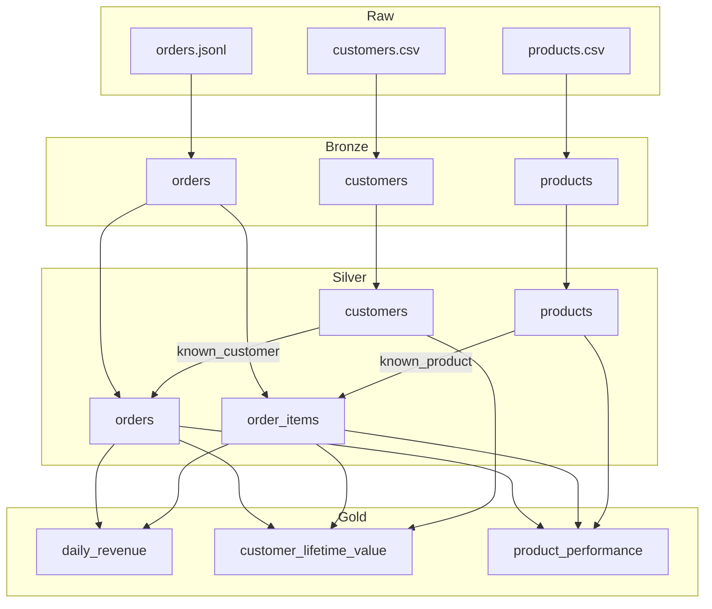

# Architecture

## Scenario

A fictional online retailer delivers three files: customers and products as CSV, and orders as
JSON Lines with nested items. The deliveries contain the problems real sources have: malformed
records, repeated orders, stale customer versions, broken references and impossible values.

The pipeline must turn them into reliable revenue reporting without losing any evidence of what
arrived.

## Data flow

## Layer contracts

### Bronze

- Every field is read as a string, so a bad value cannot fail ingestion.
- Malformed JSON is kept in `_corrupt_record`.
- Each row carries `_source_file`, `_ingested_at` and `_batch_id`.
- Data is partitioned by `_batch_id`. Overwriting is dynamic, so re-running a batch replaces only
  that batch.

### Silver

| Table | Key | Rules |
| --- | --- | --- |
| `customers` | `customer_id` | ID present, valid email, parsable `updated_at`. Newest version wins. |
| `products` | `product_id` | ID present, non-negative price, parsable `updated_at`. Newest version wins. |
| `orders` | `order_id` | Well-formed record, ID present, known customer, known status, parsable timestamp, at least one item. |
| `order_items` | `order_id`, `line_number` | Known product, positive quantity, non-negative price. |

A rule that evaluates to NULL counts as broken. Silver is rebuilt from every Bronze batch on each
run unless `--incremental` is used.

### Incremental loading

`state/watermark.json` lists the Bronze batches already merged into Silver. An incremental run
cleans only the missing batches (plus the current one, so a replay is merged again) and merges
them into the existing tables with the same rules as a full rebuild: newest `updated_at` wins for
customers and products, newest ingestion wins for orders, and a re-delivered order replaces its
lines. Quarantine rows of a replayed batch are replaced, not duplicated. Merged tables are written
to `state/staging` and swapped in, because Spark cannot overwrite a path it is reading.

Known limits: an order rejected earlier for an unknown customer is not re-evaluated when that
customer arrives in a later batch (a full rebuild would accept it), and a record that disappears
from a replayed batch stays in Silver. Atomic publishing (issue #8) is the planned fix for
partial writes.

A rejected line does not reject its order. The order stays valid and only the line moves to
quarantine, because the rest of the sale really happened.

### Gold

| Mart | Grain | Answers |
| --- | --- | --- |
| `daily_revenue` | Day (UTC) | How much do we sell per day? |
| `customer_lifetime_value` | Customer | Who are our most valuable customers? |
| `product_performance` | Product | What leads each category? |

Revenue is recognised for orders that are `placed`, `shipped` or `delivered`. Orders that were
`cancelled` or `returned` are excluded.

## Quality gate

After Gold is built, the gate checks:

- Primary key uniqueness on Silver tables and Gold marts.
- Required fields are populated.
- Referential integrity between Silver tables.
- Reconciliation: the three marts and the Silver lines report the same revenue, using exact decimal
  arithmetic.
- Rejection rate: for each entity, the share of this batch's rows that went to quarantine must not
  exceed `--max-rejection-rate` (default 10%). The rates are written to the report as
  `batch_rejection_rates`.

The rejection rate counts only rows whose `_batch_id` is the current batch. Quarantine keeps every
rejected row ever delivered, while Silver keeps one version per key, so a rate over the whole lake
would rise every time data is re-delivered and eventually fail a healthy run.

The report is written first, so a failed run still leaves evidence. The pipeline then raises
`DataQualityError` and the command exits with a non-zero code.

## Decisions

| Decision | Why | Trade-off |
| --- | --- | --- |
| Pure transformations separated from I/O | Almost all logic can be tested without touching disk | `pipeline.py` has to wire reads and writes explicitly |
| Full Silver rebuild by default, optional watermark-based merge | Rebuild is correct by construction; the merge keeps cost proportional to the delivery | The merge has the limits listed under Incremental loading |
| Quarantine tables rather than dropping or failing | Keeps evidence and lets valid data flow | Quarantine needs monitoring, done by the rejection-rate check |
| Rejection rate per batch, with one limit for every entity | Measures the delivery just received and stays simple to reason about | A record re-delivered with an older version than Silver holds counts in neither side of the rate |
| Gold in `.sql` files | Business logic stays readable by analysts and reviewable on its own | Requires a small templating step for shared constants |
| Parquet rather than Delta Lake | No extra dependency for the first version | No ACID guarantees or time travel yet |
| Synthetic data | Reproducible, free of private data, and defects are known exactly | Volumes and distributions are not those of a real business |
| Generator states expected counts | Tests compare with a source independent of the code under test | The generator has to be kept in sync when defects are added |

## Known limitations

- Rejection rates are recorded per run but not yet compared across runs, so a slow drift below the
  limit is not flagged. A history of run reports would make that possible.

- A run overwrites Silver and Gold in place, so a crash mid-write can leave a layer partly written.
- Orders that lose every line to quarantine stay in Silver without items and contribute no revenue.
- The quality gate runs after Gold is written, so a failed run leaves the failing output in place.
  It signals failure through the exit code and the report.
